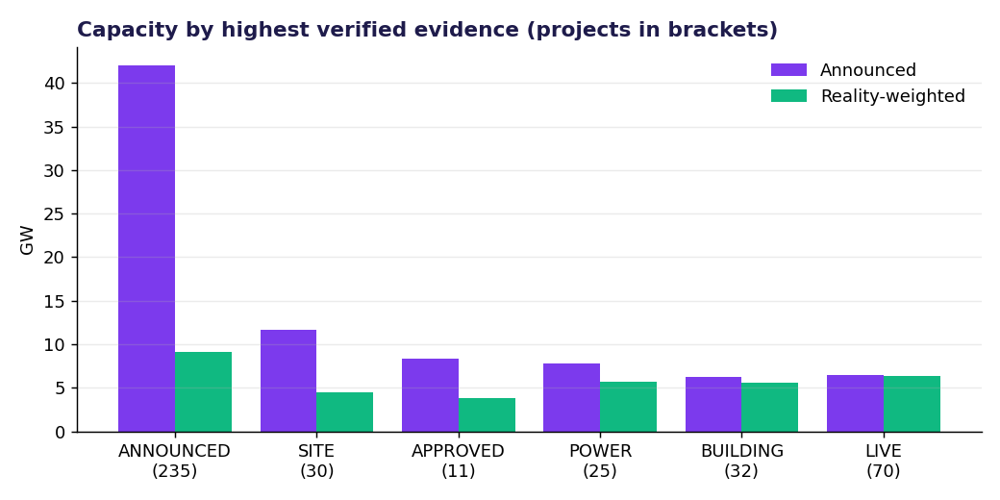
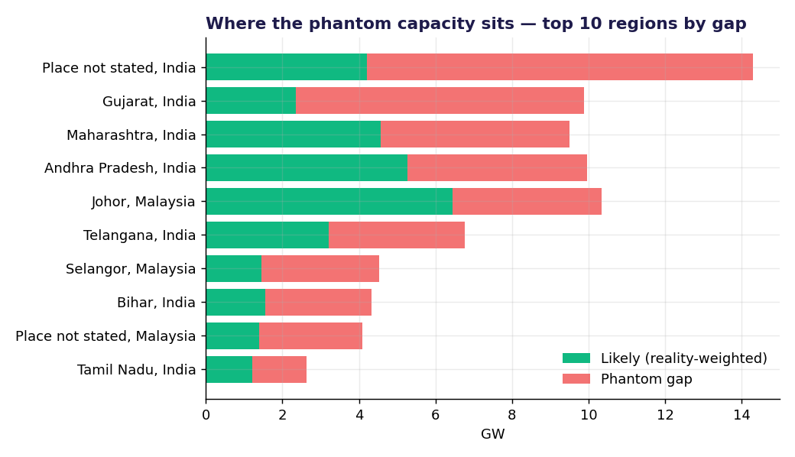
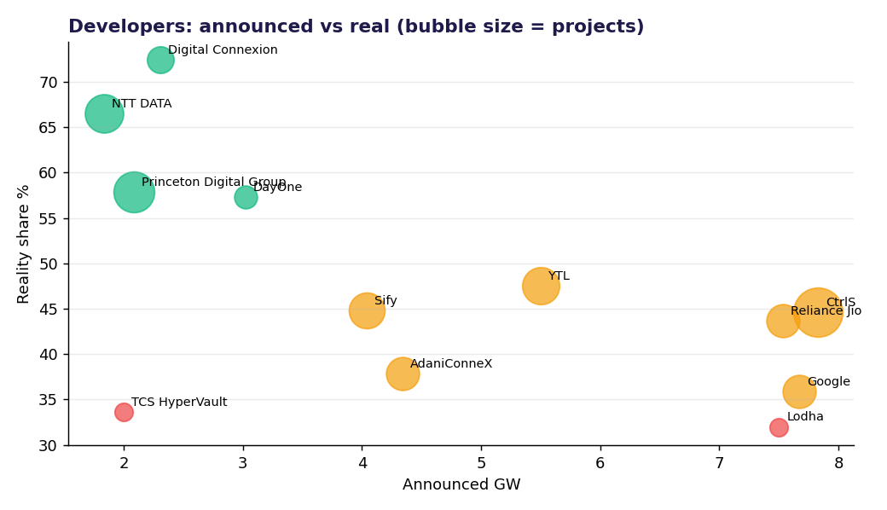
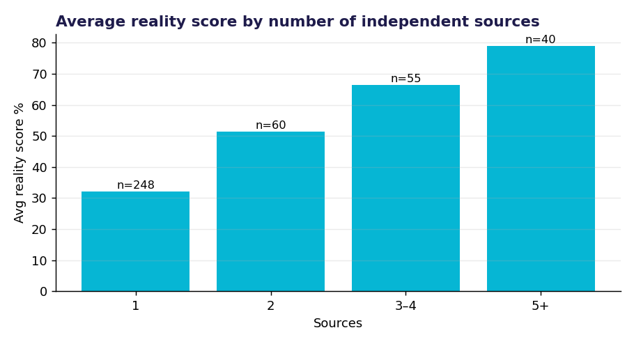
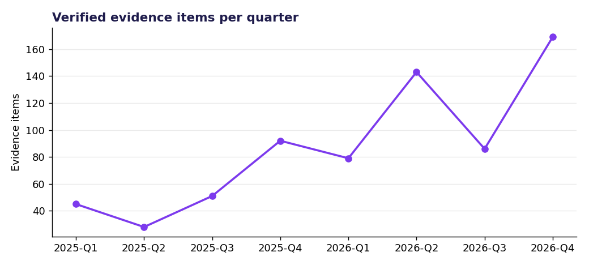

# Phantom Hunter — data analysis

Generated by `python -m app.phantom.analysis` on 2026-11-10. Every number is computed from the current database, so re-running after a new hunt updates the findings.

## Key findings

1. **Only 43% of announced capacity looks real.** 289 of 403 projects state a capacity: 82.6 GW announced, 35.1 GW reality-weighted. The other 47.5 GW is phantom risk.
2. **Most capacity is still paper.** 62.1 GW (75%) sits at ANNOUNCED / SITE / APPROVED; only 12.7 GW (15%) has verified BUILDING or LIVE evidence.
3. **The biggest gap is Place not stated, India**: 14.3 GW announced across 22 projects with a stated capacity, 4.2 GW likely — a 10.1 GW gap.
4. **The pipeline is concentrated.** The top 5 developers account for 44% of announced MW. Highest reality share among the big names: Digital Connexion (72%), NTT DATA (67%), Princeton Digital Group (58%). Lowest: Lodha (32%), TCS HyperVault (34%).
5. **Corroboration matters.** 248 projects (62%) rest on a single source and average 32%; projects with 5+ sources average 79%. The single biggest lever for confidence is a second independent source.
6. **Publishers block bots.** 5% of verified evidence comes from headlines/summaries, not full articles — which is why the scorer applies a headline-only penalty and why permit / utility filings are the next data source.
7. **Momentum is rising.** Verified evidence went from 86 items in 2026-Q3 to 169 in 2026-Q4 (the latest quarter may still be partial).
8. **Sales opportunity.** 21 projects are likely enough (≥45%), at least 50 MW, pre-construction and have **no power partner named** — 7.0 GW of reality-weighted demand an IPP could still bid for.

## Charts

### Capacity by evidence stage

### Phantom gap by region

### Developers: announced vs real

### Reality score vs number of sources

### Evidence momentum

## Score distribution

| Band | Projects |
|---|---|
| At risk (45–70%) | 23 |
| Likely (≥70%) | 113 |
| Phantom risk (<45%) | 267 |

Median reality score: 25%.

## Caveats

- Reality scores are **stated priors + named adjustments**, not yet calibrated against outcomes (see `PHANTOM_HUNTER.md` §4.4).
- Coverage reflects what public news reports; projects that never make the news are invisible (recall is not measured).
- A few projects may appear twice when the resolver was not confident enough to merge them (by design).
