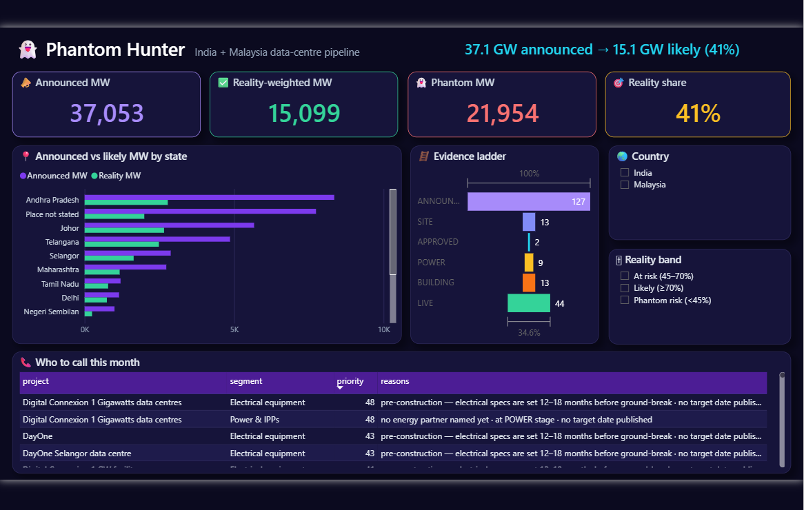

# 📊 Phantom Hunter — Analytics pack

The same data the dashboard shows, in the tools an analyst or commercial team actually uses:
**Excel, Google Sheets, Power BI and SQL**. Everything here is generated from the database by code, so it is
always consistent with the app and is refreshed by re-running three commands.

| File | What it is |
|---|---|
| [`PhantomHunter.xlsx`](PhantomHunter.xlsx) | Formatted workbook: KPI summary, filterable Excel tables, colour-scaled reality scores, a live **Analysis** sheet (SUMIFS / COUNTIFS) and native charts |
| [`data/*.csv`](data/) | Star-schema tables (UTF-8): `projects`, `who_to_call`, `evidence`, `anomalies`, `score_terms`, `articles` |
| [`sql/phantom_queries.sql`](sql/phantom_queries.sql) | 11 business questions in SQL — CTEs, CASE, JOINs, window functions (RANK, ROW_NUMBER, LAG, partitioned SUM) |
| [`SQL_RESULTS.md`](SQL_RESULTS.md) | Each question, its SQL and the live result |
| [`ANALYSIS.md`](ANALYSIS.md) | Data analysis: 8 findings (every number computed) + 5 charts |
| [`powerbi/`](powerbi/) | DAX measures + report theme for the Power BI build below |

## Regenerate

```bash
cd backend
python -m app.phantom.export       # → PhantomHunter.xlsx + data/*.csv
python -m app.phantom.sql_report   # → SQL_RESULTS.md
python -m app.phantom.analysis     # → ANALYSIS.md + charts/
```

From the running app: **📊 Excel** and **⬇ CSV** buttons on the Phantom Hunter dashboard, or
`GET /api/v1/phantom/export.xlsx` and `GET /api/v1/phantom/export/{table}.csv`.

## Data model (star schema)

```
                    ┌──────────────┐
   who_to_call ───► │              │ ◄─── evidence ───► articles (via url)
   score_terms ───► │   projects   │ ◄─── anomalies
                    │ (project_id) │
                    └──────────────┘
```

`projects` has one row per resolved project; every other table joins on `project_id` (many-to-one).
Key columns: `capacity_mw`, `reality_score` (0–1), `reality_mw = capacity × score`, `phantom_mw = capacity × (1 − score)`,
`stage_name` (ANNOUNCED → LIVE), `score_band`, `power_partner`, `n_sources`, `lat`/`lon`.

## Excel

Open `PhantomHunter.xlsx`. Sheets:

1. **Summary** — 8 KPIs, each a live formula over the Projects sheet (`=SUM(...)`, `=COUNTIF(... ,"?*")`).
2. **Analysis** — capacity by stage, by country and top-10 states with `SUMIFS` / `COUNTIFS`, plus two native bar charts.
   Filter or edit the Projects sheet and these recalculate.
3. **Projects / Who to call / Evidence / Anomalies / Score terms / Articles** — Excel tables with filters, frozen headers, a red→amber→green colour scale on `reality_score`.

## Google Sheets

Either **File → Import → Upload `PhantomHunter.xlsx`** (formulas, tables and charts carry over — the Analysis sheet only uses
functions Sheets supports), or import `data/projects.csv` and try:

```
=QUERY(projects!A:Z, "select D, sum(I), sum(L) where I is not null group by D label sum(I) 'Announced MW', sum(L) 'Reality MW'", 1)
=SUMIFS(projects!L:L, projects!P:P, "LIVE")              // reality MW with verified LIVE evidence
=FILTER(projects!B:B, projects!K:K>=0.7, projects!R:R="") // likely projects with no power partner
```

(Column letters follow `projects.csv`: B name, D country, I capacity_mw, K reality_score, L reality_mw, P stage_name, R power_partner.)

## Power BI

**Fastest (1 minute):** `python analytics/powerbi/build_pbip.py <folder>` generates a ready-made **Power BI Project**
(`PhantomHunter.pbip`: 5 tables, 4 relationships, 17 measures, a dark theme and a two-page report). Open it in Power BI Desktop →
*Refresh* → *File → Save as* → `.pbix`. (A .pbix is a binary only Power BI Desktop can write; .pbip is its text form.)



Page 2 (*Project explorer*) adds likely / phantom-risk counts, single-source share, open power MW, a size-vs-reality scatter, stage-by-country columns and a projects table with each one's weakest assumption.

**By hand (≈15 minutes):**

1. **Get data → Text/CSV** for each file in `analytics/data` (projects, who_to_call, evidence, anomalies, score_terms) → Load.
2. **Model view** — relationships (all *many → one*, single direction) from `who_to_call[project_id]`, `evidence[project_id]`,
   `anomalies[project_id]`, `score_terms[project_id]` to `projects[project_id]`.
3. Set data categories: `projects[lat]` → Latitude, `projects[lon]` → Longitude, `projects[state]` → State or Province.
4. **Modeling → New measure** — paste the measures from [`powerbi/measures.dax`](powerbi/measures.dax)
   (Announced MW, Reality MW, Phantom MW, Reality Share, Weighted Reality Score, Open Power Opportunities MW, Headline…).
5. **View → Themes → Browse** → [`powerbi/PhantomHunter_theme.json`](powerbi/PhantomHunter_theme.json).
6. Suggested one-page report:

| Visual | Fields |
|---|---|
| Card × 4 | Announced MW · Reality MW · Phantom MW · Reality Share |
| Map (bubble) | lat / lon, size = Announced MW, colour = Avg Reality Score |
| Funnel | stage_name, Projects |
| Clustered bar | state, Announced MW vs Reality MW |
| Table | who_to_call: project, segment, priority, reasons (filter segment) |
| Slicers | country, score_band, stage_name |
| Text box | `Headline` measure as dynamic title |

## SQL

`sql/phantom_queries.sql` answers the questions a commercial team asks — headline pipeline, evidence-ladder funnel,
phantom gap by state, developer league table (RANK), market share within country (partitioned SUM + ROW_NUMBER),
power-sales target list, coverage vs score, source quality, scout productivity, anomalies, quarter-on-quarter momentum (LAG).
Run them all with `python -m app.phantom.sql_report`, or open `backend/agentforge_dev.db` in any SQLite client.
